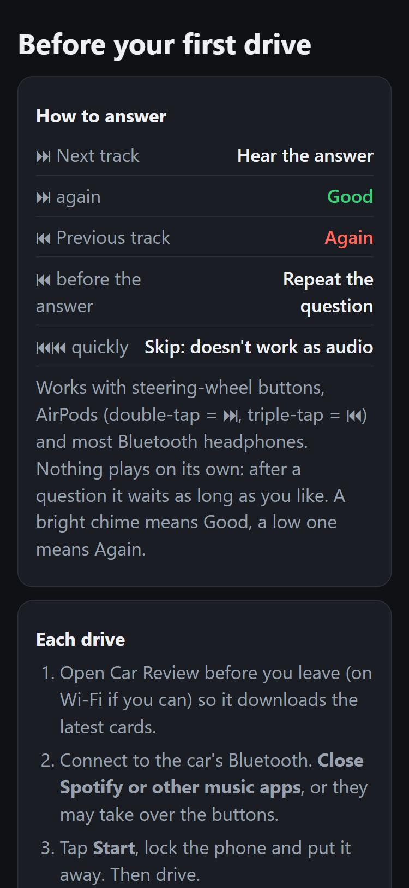

# Car Review

**Hands-free flashcard reviews while you drive.** Your phone reads your due Anki cloze cards out loud, and you answer with your car's steering-wheel buttons (or your headphones' next/previous track buttons). Your answers go back into Anki through Anki's own scheduler, exactly as if you had pressed the buttons yourself.

Free and open source. No account, no app store, no subscription. Works with Anki on Windows, Mac and Linux, and with an iPhone or Android phone.

| On your computer | On your phone |
|---|---|
|  |  |

## Quick start (about 10 minutes)

1. **Install the add-on.** In Anki, go to **Tools ▸ Add-ons ▸ Get Add-ons…**, paste the add-on code *(coming soon)* and restart Anki. Until the AnkiWeb listing is up, use the `.ankiaddon` file instead: see the [setup guide](help/setup.md#1-install-the-add-on).
2. **Follow the setup window.** It opens by itself after the restart. Tick the decks you want in the car and leave the options as they are.
3. **Set up the voice.** Press **Set up the voice**. It's a one-time download of about 340 MB, and nothing is installed system-wide. You can carry on with the next step while it downloads.
4. **Scan the QR code** with your phone's camera. Then add Car Review to your Home Screen (iPhone: Share ▸ *Add to Home Screen*; Android: ⋮ ▸ *Add to Home screen*) and open it from there.
5. **Drive.** Close Anki before you leave, and your cards go to your phone. Open Car Review, tap **Start** and put the phone away. When you arrive, open Anki: it shows your car answers and applies them.

**In the car:** ⏭ next track = hear the answer, then ⏭ again = **Good**. ⏮ previous track = **Again** (before the answer, it repeats the question instead). Double-press ⏮ to skip a card that doesn't work as audio.

> **Safety first.** Set everything up and tap Start *before* you drive. While driving, use only the steering-wheel buttons, and never look at or touch the phone. See the [terms of use](TERMS.md).

## Learn more
- [Setup guide](help/setup.md): every step in detail, with what you should see
- [How it works](help/how-it-works.md): privacy, and why your scheduling stays safe, in plain words
- [Troubleshooting and FAQ](help/troubleshooting.md): buttons not working, Spotify taking over, no audio yet, lost phone and more
- [Privacy policy](PRIVACY.md) · [Terms of use](TERMS.md)
- [For developers](CONTRIBUTING.md): how the code fits together, tests and releasing

## What it can and can't do
- **Cloze cards only** for now. Basic cards, cards with an image on the front, cards that point at a picture and AnKing "one by one" cards are skipped, and stay due in Anki as normal.
- **English voice** (Kokoro "Heart"). The audio is made on your own computer while it's plugged in. The first time, a typical laptop takes about 10 seconds per card; after that, each card is ready for good, so only new cards need audio.
- **Runs a little in the background**, all shown in Settings: audio is made after Anki closes (with a progress window), and by default the new day's list is sent at 4:30 am, which keeps a plugged-in laptop awake until then. [Details](help/how-it-works.md#a-normal-day).
- **Anki desktop** is needed. It is tested with Anki 26.09; versions from 24.11 on should work. AnkiMobile and AnkiDroid keep working as usual alongside it.

## License
[GNU AGPL v3](LICENSE). Free to use, copy and change; changed versions must stay open source.

Car Review is an independent project. It isn't affiliated with or endorsed by Anki or Ankitects.
