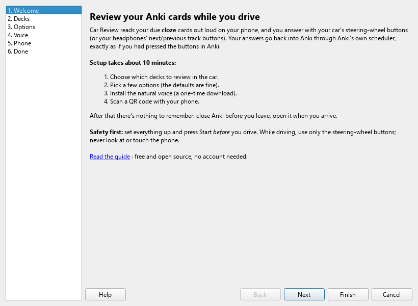
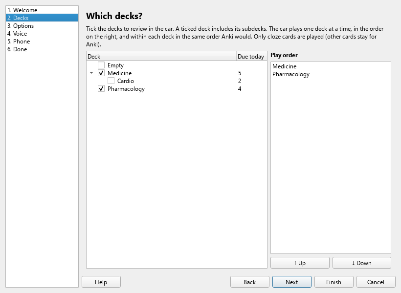
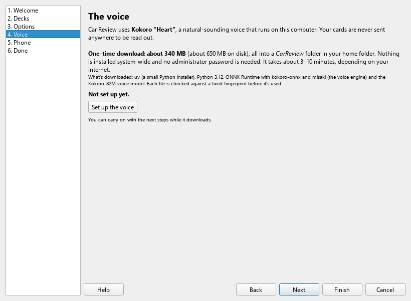
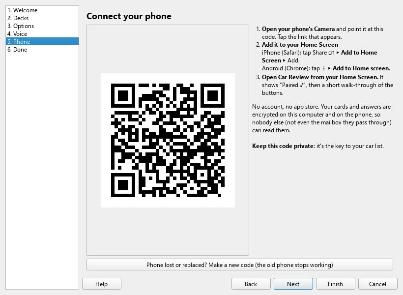

# Setup guide

This takes about 10 minutes, plus a download that runs in the background. You need:

- **Anki on a computer** (Windows, Mac or Linux), with the cards you want to review. Car Review plays **cloze** cards.
- **An iPhone or Android phone.**
- **A car with Bluetooth audio and steering-wheel track buttons** (⏭ / ⏮), or Bluetooth headphones with next/previous track controls, such as AirPods.

Nothing here needs an account, a terminal or any settings files.

---

## 1. Install the add-on

**From AnkiWeb (once the listing is up):**
1. In Anki, open **Tools ▸ Add-ons ▸ Get Add-ons…**
2. Paste the code *(coming soon)* and press OK.
3. Restart Anki.

**From a file (until then):**
1. Download `car_review.ankiaddon` from the project's [Releases page](https://github.com/AnkiCardReview/car-review/releases) *(not published yet)*.
2. Double-click the file, or in Anki use **Tools ▸ Add-ons ▸ Install from file…**
3. Restart Anki.

## 2. The setup window

A few seconds after Anki restarts, the **Car Review setup** window opens by itself. It has six steps on the left; **Next** walks through them. You can open it again any time from **Tools ▸ Car Review ▸ Settings**.

### Decks
Tick the decks to review in the car. Ticking a deck includes its subdecks. Each ticked deck appears in **Play order** on the right, and the car plays them one at a time, top to bottom. Use **↑ Up** / **↓ Down** (or drag) to change the order.

The first time, every top-level deck with cards due is ticked for you. That's a fine start.

### Options
The defaults suit most people:
- **Also send cards due in the next 3 days**, so the phone still has cards if you don't open Anki for a day or two. Cards are only ever played on the day they're due.
- **Make new audio by itself when I close Anki while plugged in** (on). Leave this on.
- **Apply my car answers as soon as Anki opens, without asking first** (off). While it's off, Anki shows you what your car answers will do and waits for you to click **Apply**.

### Voice
Press **Set up the voice**. Car Review downloads its own voice, about **340 MB**, into a folder called `CarReview` in your home folder:
- uv, a small open-source installer
- a private copy of Python 3.12
- the voice engine (ONNX Runtime, kokoro-onnx and misaki)
- the Kokoro "Heart" voice

Nothing is installed system-wide, and you won't be asked for an administrator password. Every file is checked against a fixed fingerprint before it's used. It takes about 3–10 minutes; you can press **Next** and carry on while it runs. When it's done you'll see **✓ The voice is ready.**

### Phone
1. Open your phone's **Camera** and point it at the QR code. Tap the link that appears.
2. **Add Car Review to your Home Screen:**
   - **iPhone (Safari):** tap Share **□↑** ▸ **Add to Home Screen** ▸ **Add**.
   - **Android (Chrome):** tap **⋮** ▸ **Add to Home screen** (or **Install app**) ▸ **Add**.
3. **Open Car Review from the Home Screen icon.** On iPhone this matters: the Home Screen app keeps its own storage, separate from Safari.

The phone shows **Paired ✓** and a short walk-through of the buttons and a safety note. Tap **I understand**.

### Done
The last step lists anything still missing and what happens from now on. If the voice is ready, press **Make audio and send to my phone now**, ideally with the computer plugged in. A small window shows progress. The first time, this takes roughly 10 seconds per card on a typical laptop (faster on newer computers). You can keep using the computer while it works, and it pauses on battery. Cards appear on the phone in batches as they're ready, so you don't have to wait for the end.

Press **Finish**.

## 3. Your first drive

**Before you leave:**
1. Close Anki on the computer. It sends your due cards to the phone. (If you just did "Make audio and send", that's already happened.)
2. Open Car Review on the phone, ideally on Wi-Fi. It downloads the cards and their audio. **Cards for today** and **Ready offline** show how many are ready.
3. Connect the phone to your car's Bluetooth. **Close Spotify or any other music app**, or it may take over the buttons.
4. Tap **Start**, lock the phone and put it away. It plays the first question.

**While driving:**

| You hear | ⏭ next track | ⏮ previous track |
|---|---|---|
| A question (or silence after it) | Hear the answer | Repeat the question |
| A question, pressed twice quickly | | Skip: "doesn't work as audio" |
| The answer | **Good** (bright chime) | **Again** (low chime) |

Nothing plays on its own: after a question, it waits silently as long as you like. Cards you answer **Again** come back after your learning step, just as in Anki.

> **Safety:** set up and tap Start before you move. While driving, use only the steering-wheel buttons and never look at or touch the phone. If a card needs thought, let it wait.

**When you arrive:**
Open Anki on the computer **first**, before reviewing on another device. After its usual sync, Car Review shows your car answers ("120 answers for 95 cards…") with an **Apply** button. Anki makes a backup first, and **Edit ▸ Undo** reverts everything in one step. Then Anki syncs as usual, so AnkiMobile or AnkiDroid see those cards as done.

## 4. Every day after that

Your routine doesn't change: **close Anki when you leave, open it when you arrive.** Car Review sends fresh cards each time Anki closes, makes audio for new cards while the computer is plugged in, and offers to apply your car answers when Anki opens.

## Changing things later
- **Decks, options, voice, phone:** Tools ▸ Car Review ▸ Settings
- **New or lost phone:** Tools ▸ Car Review ▸ Pair phone ▸ *Make a new code*
- **Something's not right:** see [Troubleshooting](troubleshooting.md)

## Removing Car Review
1. In Anki, **Tools ▸ Add-ons**, select Car Review and press **Delete**.
2. Delete the `CarReview` folder in your home folder (the voice, audio and pairing).
3. On the phone, delete the Car Review icon. On iPhone, also go to Settings ▸ Apps ▸ Safari ▸ Advanced ▸ Website Data and remove `ankicardreview.github.io`.

Your Anki collection and review history aren't affected: car answers become normal Anki reviews once they're applied.
